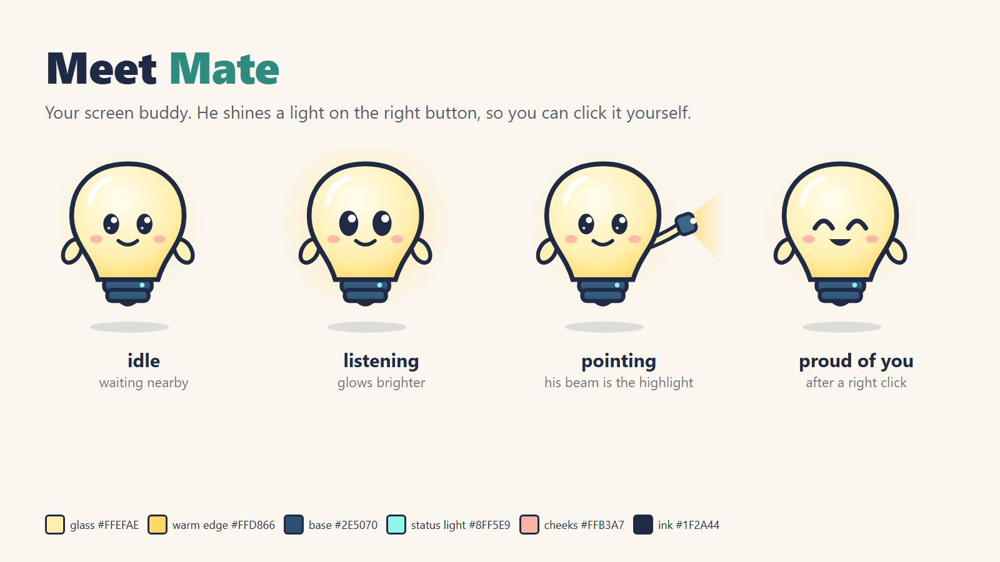
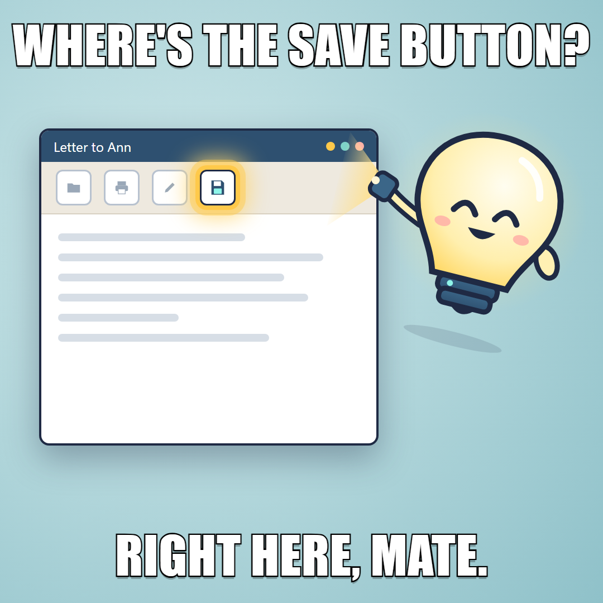

# MetaMate

**A patient desktop robot that shows you where to click, checks your progress, and lets you stay in control.**



> **Project status:** Hackathon build in progress (October 26 - November 4, 2026). Windows only.

## What it does



- Hold to talk and ask in any language.
- Mate points at the right button in any app, then waits for you to click.
- Hear helpful sound cues, or use calm mode designed for older users.

## Why it is different

Mate is a **teacher, not an autonomous agent**: he guides one step at a time instead of taking over. He checks that you clicked the right target before moving on, and says when he cannot find something rather than guessing. Screen capture is limited to the active window and its popups, only for a request; password fields are blacked out before anything is sent. Provider keys stay out of the desktop app.

## How it works

```text
Voice: hold to talk → Muse Voice Transcribe → Muse Spark → MateScript → MMS-TTS
Screen: active window → UI Automation (UIA) + computer use → SAM 3.1 fallback
                                                    ↓
                                        Mate points; you click
```

UIA grounds suggestions in app controls; computer use helps plan steps, and SAM 3.1 can refine a visual target when accessibility data is missing. Mate clicks for you only when you say "do it for me" and confirm, and never on payments, deletions or passwords.

## Built with Meta

| Meta model | Role in MetaMate |
|---|---|
| Muse Voice Transcribe | Real-time speech recognition |
| Muse Spark 1.3 | Understands requests and guides tasks |
| Muse Wonder 1.0 | Optional: choose it in settings for harder tasks; Spark stays the default |
| SAM 3.1 | Refines visual targets when UIA is unavailable |
| Muse Image | Develops concepts for Mate's character |
| MMS-TTS | Gives Mate a voice; Meta open weights, served via Modal |

## MateScript in 10 lines

MateScript is a small streaming format for speech, pointing, mood, and sound cues. [Read the draft specification](docs/matescript.md).

```text
<lang en>
<mood calm>
I can show you how to make the text bigger.
<step 1/2 e3>
Open Accessibility.
<wait click>
<step 2/2 e8>
Choose Text size.
<wait click>
<sfx success soft><mood proud>That's it. Well done!
```

## Repository map

| Path | Contents |
|---|---|
| [`docs/`](docs/) | Strategy, architecture, plan, MateScript, safety, and design |
| [`tools/`](tools/) | Project checks, tests, and developer utilities |
| [`assets/art/`](assets/art/) | Mate concepts and artwork |
| `crates/`, `src-tauri/`, `src/` | Planned Rust core, Tauri shell, and TypeScript interface |
| `server/`, `tts/` | Planned API proxy and MMS-TTS service |

The `mm` helper is available from Git Bash as `./mm <command>` or PowerShell as `.\mm <command>`. Common commands:

| Command | Purpose |
|---|---|
| `mm doctor` | Check development tools |
| `mm status` | Show project and schedule status |
| `mm check` | Run fast project checks |
| `mm test` | Run available unit tests |

## Status, roadmap, and privacy

The hackathon build started at kickoff on October 26, 2026 and ends November 4, 2026. See the [day-by-day roadmap](docs/plan.md).

Privacy principles: inspect only the active window and its popups, and only during a request; black out password fields before sending a screenshot; keep provider keys out of the app. The proxy is designed not to store request or response content.

## Prepared before the kickoff

The hackathon build runs from October 26 to November 4, 2026. Before the kickoff we prepared only non-product material, in the open: the design documents in `docs/`, the developer tooling in `tools/` (project CLI, checks, UI Automation dump, sound synthesis and licence-checked sound fetching), the concept art in `assets/art/` and the synthesized cue sounds in `assets/sounds/`. No application code existed before the kickoff; the git history starts after it.

See [CHANGELOG.md](CHANGELOG.md) for the pre-kickoff preparation record.

## License

Project license: **TBD**. The MMS-TTS model weights are licensed **CC-BY-NC-4.0**; see the [architecture notes](docs/architecture.md) for details.
